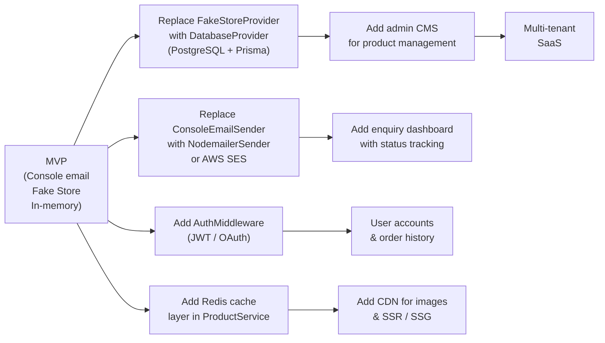

# Product Catalogue MVP – Implementation Plan

> **Role:** Senior Full-Stack Software Architect  
> **Time-box:** 2–3 hours  
> **Status:** Awaiting approval before coding begins

---

## 1. Acceptance Criteria Analysis

| # | Requirement | Notes |
|---|-------------|-------|
| 1 | Home page with **exactly five** featured products | Backend must enforce the `limit=5` rule; not a frontend concern |
| 2 | Category navigation + category product listing | Fake Store API exposes `/products/categories` and `/products/category/:name` |
| 3 | Search products by matching text | Fake Store API has no native search → server-side filter on `title` + `description` |
| 4 | Individual product details page | Route: `/products/:id` |
| 5 | Product enquiry form | Fields: name, email, message, productId (hidden) |
| 6 | Thank-you confirmation after enquiry submission | Client-side route change post-POST |
| 7 | Email-provider abstraction | Interface + console adapter for MVP; real SMTP/SES can drop in later |

---

## 2. Architecture Overview

```
┌─────────────────────────────────────────────────────────┐
│                     Browser (React)                     │
│  React Router · TanStack Query · SCSSS                  │
└──────────────────────┬──────────────────────────────────┘
                       │  HTTP (REST JSON)
                       ▼
┌─────────────────────────────────────────────────────────┐
│                  Express API Server                     │
│  Route Handlers → Service Layer → Product Provider      │
│                            ↓                            │
│                   Email Abstraction                     │
└──────────────────────┬──────────────────────────────────┘
                       │  HTTPS
                       ▼
              ┌────────────────────┐
              │   Fake Store API   │
              │  fakestoreapi.com  │
              └────────────────────┘
```

### Key architectural constraints

- **Frontend never calls Fake Store API.** All data flows through the Express backend.
- **Route handlers are thin.** They validate input (Zod), call a service, and return a response.
- **Product provider is an interface.** `FakeStoreProvider` implements it; a real database provider can replace it without touching any service or route.
- **Email sender is an interface.** `ConsoleEmailSender` logs to stdout for MVP; `NodemailerSender` or `SESEmailSender` can replace it via an env variable.

---

## 3. Backend REST Endpoints

Base path: `/api`

| Method | Path | Description | Query params |
|--------|------|-------------|--------------|
| `GET` | `/api/products/featured` | Returns exactly 5 featured products | — |
| `GET` | `/api/products` | Returns all products (optional search) | `?q=<text>` |
| `GET` | `/api/products/:id` | Returns one product by ID | — |
| `GET` | `/api/categories` | Returns list of all categories | — |
| `GET` | `/api/categories/:name/products` | Returns all products in a category | — |
| `POST` | `/api/enquiries` | Submit a product enquiry | body (JSON) |
| `GET` | `/api/health` | Health check | — |

### Request / Response Contracts

#### `GET /api/products/featured`
```json
// 200 OK
{
  "data": [
    { "id": 1, "title": "...", "price": 9.99, "image": "...", "category": "...", "rating": { "rate": 4.5, "count": 120 } }
    // × 5
  ]
}
```

#### `GET /api/products?q=jacket`
```json
// 200 OK
{ "data": [ /* matching products */ ] }
```

#### `GET /api/products/:id`
```json
// 200 OK
{ "data": { "id": 1, "title": "...", "price": 9.99, "description": "...", "image": "...", "category": "...", "rating": { "rate": 4.5, "count": 120 } } }
// 404 Not Found
{ "error": "Product not found" }
```

#### `GET /api/categories`
```json
// 200 OK
{ "data": ["electronics", "jewelery", "men's clothing", "women's clothing"] }
```

#### `GET /api/categories/:name/products`
```json
// 200 OK
{ "data": [ /* products */ ] }
// 404 Not Found
{ "error": "Category not found" }
```

#### `POST /api/enquiries`
```json
// Request body
{ "productId": 1, "name": "Jane Doe", "email": "jane@example.com", "message": "Is this available in blue?" }

// 201 Created
{ "data": { "id": "enq_abc123", "submittedAt": "2024-01-01T00:00:00Z" } }

// 422 Unprocessable Entity (validation failure)
{ "error": "Validation failed", "details": [ { "field": "email", "message": "Invalid email" } ] }
```

---

## 4. Folder Structure

```
shopKart/
├── docker-compose.yml          # Orchestrates frontend + backend in dev
├── .env.example                # Documented env vars (never commit .env)
├── IMPLEMENTATION_PLAN.md
├── DECISIONS.md
│
├── backend/
│   ├── package.json
│   ├── tsconfig.json
│   ├── Dockerfile
│   ├── .env.example
│   └── src/
│       ├── index.ts            # Express app bootstrap + server listen
│       ├── app.ts              # Express app factory (testable without listen)
│       ├── config.ts           # Typed env var loader (dotenv + Zod)
│       │
│       ├── routes/
│       │   ├── products.ts     # GET /api/products/*
│       │   ├── categories.ts   # GET /api/categories/*
│       │   └── enquiries.ts    # POST /api/enquiries
│       │
│       ├── services/
│       │   ├── product.service.ts    # Business logic: featured, search, by id
│       │   ├── category.service.ts   # Business logic: list, products by category
│       │   └── enquiry.service.ts    # Business logic: validate + dispatch email
│       │
│       ├── providers/
│       │   ├── product.provider.ts         # IProductProvider interface
│       │   └── fake-store.provider.ts      # FakeStore HTTP implementation
│       │
│       ├── email/
│       │   ├── email.sender.ts             # IEmailSender interface
│       │   └── console.email.sender.ts     # Logs email to stdout (MVP)
│       │
│       ├── schemas/
│       │   ├── product.schema.ts           # Zod schemas + inferred types
│       │   ├── category.schema.ts
│       │   └── enquiry.schema.ts           # Enquiry request body schema
│       │
│       ├── middleware/
│       │   ├── error.middleware.ts         # Global error handler
│       │   └── not-found.middleware.ts
│       │
│       └── __tests__/
│           ├── products.routes.test.ts
│           ├── categories.routes.test.ts
│           ├── enquiries.routes.test.ts
│           └── product.service.test.ts
│
└── frontend/
    ├── package.json
    ├── tsconfig.json
    ├── vite.config.ts
    ├── tailwind.config.ts
    ├── Dockerfile
    ├── index.html
    └── src/
        ├── main.tsx            # React entry + Router + QueryClient
        ├── App.tsx             # Route definitions
        ├── env.ts              # Typed import.meta.env
        │
        ├── api/
        │   └── client.ts       # Fetch wrapper (base URL, error handling)
        │
        ├── hooks/
        │   ├── useFeaturedProducts.ts
        │   ├── useProducts.ts
        │   ├── useProduct.ts
        │   ├── useCategories.ts
        │   └── useCategoryProducts.ts
        │
        ├── pages/
        │   ├── HomePage.tsx
        │   ├── CategoryPage.tsx
        │   ├── SearchPage.tsx
        │   ├── ProductDetailPage.tsx
        │   ├── EnquiryPage.tsx
        │   └── ThankYouPage.tsx
        │
        ├── components/
        │   ├── layout/
        │   │   ├── Header.tsx          # Nav + search bar + category links
        │   │   └── Footer.tsx
        │   ├── product/
        │   │   ├── ProductCard.tsx     # Reusable card (image, title, price, CTA)
        │   │   ├── ProductGrid.tsx     # Responsive grid wrapper
        │   │   └── ProductDetail.tsx   # Full detail view
        │   ├── forms/
        │   │   └── EnquiryForm.tsx     # Controlled form with validation
        │   └── ui/
        │       ├── Spinner.tsx
        │       ├── ErrorMessage.tsx
        │       └── Badge.tsx           # Category badge
        │
        ├── types/
        │   └── api.types.ts    # Shared TypeScript interfaces (mirrors backend Zod types)
        │
        └── __tests__/
            ├── HomePage.test.tsx
            ├── ProductCard.test.tsx
            ├── EnquiryForm.test.tsx
            └── ProductDetailPage.test.tsx
```

---

## 5. Required Dependencies

### Backend

| Package | Purpose |
|---------|---------|
| `express` | HTTP server |
| `cors` | Allow cross-origin requests from frontend dev server |
| `dotenv` | Load `.env` file |
| `zod` | Schema validation for env vars and request bodies |
| `node-fetch` / native `fetch` (Node 18+) | Call Fake Store API |
| `typescript` | Type safety |
| `ts-node` / `tsx` | Run TypeScript directly in dev |
| `nodemon` | Watch + restart in dev |
| **Dev / Test** | |
| `vitest` | Test runner |
| `supertest` | HTTP integration tests against Express app |
| `@types/express`, `@types/cors`, `@types/supertest` | Type definitions |

### Frontend

| Package | Purpose |
|---------|---------|
| `react`, `react-dom` | UI framework |
| `react-router-dom` | Client-side routing |
| `@tanstack/react-query` | Server state, caching, loading/error states |
| `tailwindcss`, `autoprefixer`, `postcss` | Utility-first styling |
| `typescript` | Type safety |
| `vite` | Dev server + bundler |
| **Dev / Test** | |
| `vitest` | Test runner |
| `@testing-library/react`, `@testing-library/user-event` | Component testing |
| `@testing-library/jest-dom` | DOM matchers |
| `jsdom` | DOM environment for Vitest |
| `msw` | Mock Service Worker — intercepts API calls in tests |

### Infrastructure

| Tool | Purpose |
|------|---------|
| Docker + Docker Compose | Local orchestration |

> **No paid services.** All dependencies are open-source or free tiers.

---

## 6. Assumptions & Trade-offs

| Topic | Decision | Rationale |
|-------|----------|-----------|
| **Persistence** | No database — enquiries logged to console | MVP scope; avoids Docker DB complexity |
| **Search** | Server-side string filter (`includes`) | Fake Store API has no search endpoint; acceptable at this scale |
| **Featured products** | First 5 from `/products?limit=5` | Simple and deterministic; could be curated via config later |
| **Authentication** | None | Out of scope for catalogue browsing + enquiry |
| **Sessions / CSRF** | None | No auth = no session; acceptable for MVP enquiry form |
| **Email** | Console sender only | Real SMTP would require secrets not suitable for a demo |
| **Caching** | TanStack Query client-side cache (`staleTime` 5 min) | Reduces redundant calls to Fake Store; no server-side cache needed |
| **Error boundary** | Single top-level React error boundary | Sufficient for MVP |
| **Pagination** | None | Fake Store returns ≤20 products per category — manageable without pagination |
| **Accessibility** | Semantic HTML + keyboard nav on forms | Full WCAG audit is out of scope but basics are covered |
| **Image CDN** | Fake Store images served as-is | No image optimisation needed for MVP |

---

## 7. Minimum Testing Strategy

### Backend (Vitest + Supertest)

| Test | Type | What it verifies |
|------|------|-----------------|
| `GET /api/products/featured` | Integration | Returns exactly 5 items |
| `GET /api/products?q=jacket` | Integration | Returns only matching products |
| `GET /api/products/:id` → 404 | Integration | Unknown ID returns 404 |
| `GET /api/categories` | Integration | Returns array of strings |
| `GET /api/categories/:name/products` | Integration | Returns products for category |
| `POST /api/enquiries` – valid | Integration | Returns 201 with id + timestamp |
| `POST /api/enquiries` – invalid email | Integration | Returns 422 with field errors |
| `ProductService.getFeatured()` | Unit | Slices exactly 5 from provider result |
| `ProductService.search(q)` | Unit | Filters by title and description |

> Fake Store API calls are mocked via a stub `IProductProvider` — no network calls in tests.

### Frontend (Vitest + RTL + MSW)

| Test | Type | What it verifies |
|------|------|-----------------|
| `<ProductCard />` | Component | Renders title, price, image; link navigates correctly |
| `<EnquiryForm />` | Component | Shows validation errors; submits on valid input |
| `<HomePage />` | Integration | Renders exactly 5 product cards (MSW stub) |
| `<ProductDetailPage />` | Integration | Renders product data; enquiry button navigates |

### Coverage target
- Aim for **≥ 80% line coverage** on services and form components within the time-box.
- Use `vitest --coverage` with `@vitest/coverage-v8`.

---

## 8. Implementation Sequence

> Designed to be runnable in **~2.5 hours** in a single focused session.

```
Phase 1 · Project Scaffolding                    (~15 min)
  ├─ Initialise monorepo root
  ├─ Create backend/ with Express + TS + Vitest
  ├─ Create frontend/ with Vite + React + TS + Tailwind
  └─ Add docker-compose.yml

Phase 2 · Backend Core                           (~35 min)
  ├─ Config loader (Zod + dotenv)
  ├─ IProductProvider interface + FakeStoreProvider
  ├─ IEmailSender interface + ConsoleEmailSender
  ├─ ProductService + CategoryService + EnquiryService
  └─ Zod schemas (Product, Category, Enquiry request)

Phase 3 · Backend Routes                         (~20 min)
  ├─ /api/products (featured, list, search, detail)
  ├─ /api/categories (list, products by category)
  ├─ /api/enquiries (POST)
  └─ Error + 404 middleware

Phase 4 · Backend Tests                          (~20 min)
  ├─ Supertest integration tests (all routes)
  └─ Unit tests for ProductService (featured + search)

Phase 5 · Frontend API Layer                     (~15 min)
  ├─ api/client.ts (fetch wrapper)
  ├─ Shared types (api.types.ts)
  └─ TanStack Query hooks (5 hooks)

Phase 6 · Frontend Pages & Components           (~35 min)
  ├─ Layout: Header (nav + search) + Footer
  ├─ ProductCard + ProductGrid
  ├─ HomePage (5 featured)
  ├─ CategoryPage
  ├─ SearchPage
  ├─ ProductDetailPage
  ├─ EnquiryForm + EnquiryPage
  └─ ThankYouPage

Phase 7 · Frontend Tests                         (~15 min)
  ├─ MSW handlers for all API endpoints
  ├─ ProductCard component test
  ├─ EnquiryForm validation test
  └─ HomePage integration test

Phase 8 · Polish & Wiring                        (~5 min)
  ├─ .env.example files
  ├─ README with setup instructions
  └─ Final smoke test via docker-compose up
```

---

## 9. What is Unnecessary for this MVP

| Item | Reason to exclude |
|------|------------------|
| Database (PostgreSQL, SQLite, etc.) | No persistence required — enquiries are fire-and-forget |
| Authentication / JWT | No user accounts in scope |
| Redux / Zustand | TanStack Query covers all remote state; no complex local state |
| GraphQL | REST is sufficient; GraphQL adds setup overhead |
| Server-side rendering (Next.js) | Vite SPA is simpler and meets requirements |
| CI/CD pipeline | Out of scope for a local take-home challenge |
| Rate limiting / helmet | Nice to have, not required for the demo |
| Pagination | Fake Store dataset is small enough |
| Real email sending | Console adapter is sufficient for demonstrating the abstraction |
| Internationalisation (i18n) | Single language requirement |
| Storybook | Component library tooling is overkill for this scale |

---

## 10. Evolution Beyond the MVP



**Provider swap:** To replace Fake Store with a real database, implement `IProductProvider` with a Prisma-backed class and change one line in the service factory. No route or service code changes.

**Email swap:** Set `EMAIL_PROVIDER=nodemailer` in `.env` and wire `NodemailerSender` in the email factory. The enquiry service is untouched.

**Search upgrade:** Add a `SearchProvider` (Elasticsearch or Postgres full-text) behind the same `search(q)` method on `IProductProvider`.

---

*Document version 1.0 — ready for review.*
